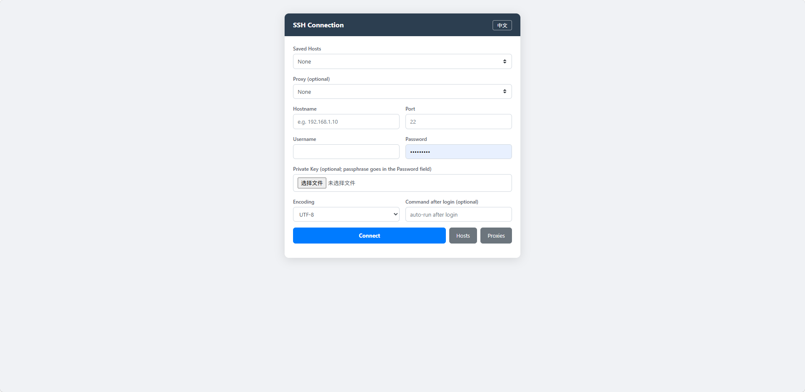
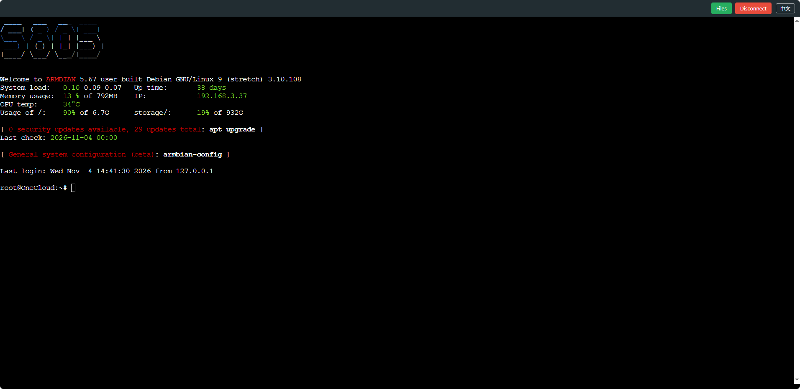
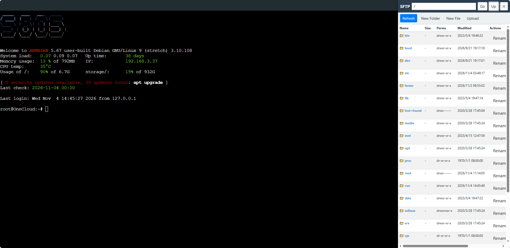

# gowebssh

A simple zero-dependency web SSH client written in Go — single binary, open in a browser and connect to any SSH host.

Forked from [leffss/gowebssh](https://github.com/leffss/gowebssh), with major enhancements: proxy chains, SFTP file manager, session auditing, i18n, and more.

## Screenshots

| Connection Form | Terminal | SFTP Panel |
|---|---|---|
|  |  |  |

## Features

- Web terminal (xterm.js 5.x), single session per page — a new connection replaces the old one
- SFTP file manager: browse / upload / download / rename / delete / new folder / **create text files inline**
- SZ/RZ (zmodem) file transfer support
- Auto-reconnect on network loss (3 attempts); clean exit on shell `exit` without reconnect
- SSH keepalive + WebSocket ping/pong heartbeat
- Terminal enhancements: WebGL rendering, search (Ctrl+F), web links, copy-on-select, right-click paste
- Encoding selection (UTF-8 / GBK / Big5) for legacy servers
- SSH proxy chains (socks5 / http), host & proxy management pages
- **i18n: English / 中文, switchable in-page, auto-detected from browser language**
- Session audit logging, HTTP Basic auth (optional), same-origin WebSocket check, optional HTTPS

## Usage

Download a binary from [Releases](https://github.com/ghc931227/gowebssh/releases) (linux-amd64 / linux-arm64 / **linux-armv7 for OneCloud 玩客云** / windows / macOS), or build:

```
go build
```

```
gowebssh [-p port] [-auth user:password] [-cert cert] [-key key] [-audit dir] [-session-ttl 60s]
```

| Flag | Description |
|---|---|
| `-p` | Listen port, default `2223` |
| `-auth` | HTTP Basic auth as `user:password`. **If unset, no login is required**; if set, all pages and APIs require login |
| `-cert` / `-key` | TLS cert & key — enable HTTPS when both are set |
| `-audit` | Session audit directory, default `sessions` (terminal output is logged per session; set `-audit=` to disable) |
| `-session-ttl` | Expiry for sessions not taken over by websocket, default `60s` |

Examples:

```
# plain HTTP with auth
gowebssh -p 2223 -auth admin:yourpassword

# HTTPS + auth + audit
gowebssh -p 2223 -auth admin:yourpassword -cert cert.pem -key key.pem
```

## 中文说明

单二进制 Web SSH 客户端。主要功能：SFTP 文件管理（含新建文本文件）、zmodem 上传下载、断线自动重连、SSH/WebSocket 双向心跳、WebGL 渲染与终端搜索、编码选择（UTF-8/GBK/Big5）、代理跳板、会话审计、可选 Basic 认证与 HTTPS。单页面单会话，新连接自动替换旧会话。界面支持中英文切换（默认按浏览器语言检测），右上角"中文/EN"按钮切换。

| 参数 | 说明 |
|---|---|
| `-p` | 监听端口，默认 `2223` |
| `-auth` | HTTP Basic 认证 `user:password`，不设置则无需登录 |
| `-cert` / `-key` | TLS 证书与私钥，同时设置后启用 HTTPS |
| `-audit` | 会话审计目录，默认 `sessions`（`-audit=` 关闭） |
| `-session-ttl` | 未被 websocket 接管的会话过期时间，默认 `60s` |

发版：推送 `v*` 标签后 GitHub Actions 自动构建全平台二进制并发布 Release。

## License

MIT
